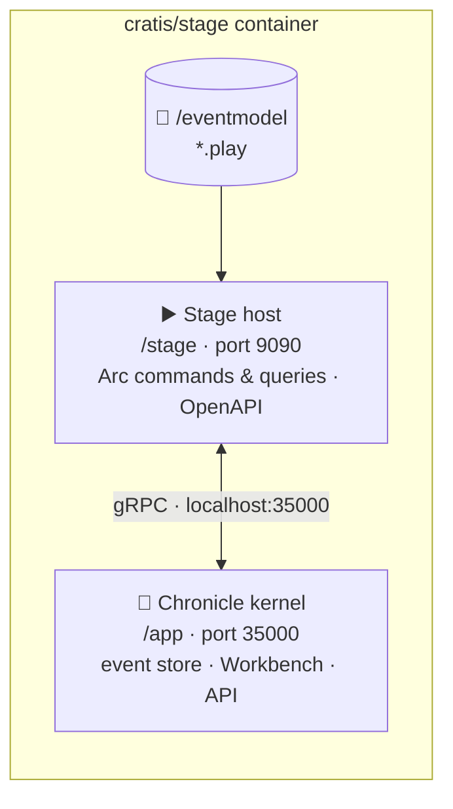

`cratis/stage` is a **play sandbox**: one container holding everything needed to perform an event model. There
is no database to provision, no Chronicle server to point at, and nothing left behind when it stops. That is
deliberate — a play session is meant to be started, poked at, and thrown away.

```bash
docker run --rm -p 9090:9090 -p 35000:35000 -v "$PWD":/eventmodel:ro cratis/stage:latest
```

## What is inside

The image is built **on top of the Chronicle kernel image** (`cratis/chronicle`), so the event store and the
engine performing the model live side by side and talk over localhost:



Three things about that base image are worth knowing:

- **The kernel is pinned to the version the host's Chronicle client is built against.** The Dockerfile names an
  exact `cratis/chronicle:<version>-development` tag — the same version `Directory.Packages.props` pins for the
  `Cratis.Chronicle` client — rather than `latest`. The two talk gRPC over a contract that changes between
  Chronicle versions, so letting either float is how a client and a kernel end up disagreeing about a message
  shape and the host fails at boot.
- **Storage is fully in-memory.** The MongoDB install the Chronicle image ships with is purged from the layer and
  the kernel is started with `Cratis__Chronicle__Storage__Type=InMemory`. The image carries no database, and
  every session starts empty.
- **The Stage host is a framework-dependent publish copied in, not compiled in the Docker build.** The
  `dotnet publish` output is produced on the host (by `dockerize.sh` or the publish workflow) and only copied
  into the image, because portable IL does not need to be recompiled per architecture.

## How it boots

`entrypoint-stage.sh` runs both processes in order:

1. **Check the selected input**, defaulting to `/eventmodel`. A missing path, a file without a `.play`
   extension, or a folder without `.play` files fails before the Chronicle kernel starts. File extensions are
   case-insensitive. This checks the input path, not the validity or executable capabilities of the model.
2. **Start the Chronicle kernel** from `/app` with in-memory storage, and with its API and Workbench features
   turned on explicitly.
3. **Wait for the kernel** — it polls port `35000` until the gRPC endpoint accepts connections, so the Stage
   never races ahead of the event store it needs.
4. **Start the Stage host** with the selected path. It compiles just that file, or compiles every `.play` file
   beneath the folder as one application using Screenplay's folder compiler. The host materializes the runtime
   constructs it currently supports; projections are registered with Chronicle once the host has started.

Each session gets a generated, Docker-style event store name (`brave-mendel`, `nifty-turing`, …), which is what
you will see in the log line the host prints and in the Workbench.

## Ports

| Port | Protocol | What it serves |
|---|---|---|
| `9090` | HTTP | The model's API — commands, queries, OpenAPI and the Scalar reference. See [URLs of a running Stage](../reference/urls.md). |
| `35000` | HTTPS | The Chronicle kernel: gRPC (HTTP/2) for the Stage's own client, plus the **Chronicle Workbench**, its API and OAuth (HTTP/1.1) on the same port. |

Those two are all a caller needs. The kernel's remaining ports (Orleans clustering on `11111` and `30000`) are
internal to the container and can be ignored.

:::caution
**Port `35000` is HTTPS only — reach it as `https://localhost:35000`.** Kestrel can only serve HTTP/1.1 and
HTTP/2 on a single port over TLS, where ALPN negotiates the protocol per connection, so the kernel has no
plaintext mode for this port. A plain `http://` request to it gets no reply at all — `ERR_EMPTY_RESPONSE` in a
browser, `curl: (52) Empty reply from server` on the command line.

The certificate is a self-signed development one the kernel generates when none is configured, so a browser
warns the first time you open the Workbench, and command-line clients need `curl -k` (or the equivalent).
:::

## Mounting the model

The model is read from `/eventmodel` inside the container:

```bash
docker run --rm -p 9090:9090 -p 35000:35000 \
    -v /path/to/screenplays:/eventmodel:ro \
    cratis/stage:latest
```

The folder is searched recursively, so a model split across many `.play` files in nested folders works as-is.
`/eventmodel` is a plain directory rather than a declared volume, which means a model can also be pushed in
through the container archive API instead of a bind mount — that is how tooling that has no host folder to share
(Studio, for one) supplies a model.

To load a single file, mount only that file read-only and pass its container path after the image name:

```bash
docker run --rm -p 9090:9090 -p 35000:35000 \
    -v /path/to/invoicing.play:/eventmodel/input.play:ro \
    cratis/stage:latest /eventmodel/input.play
```

The entrypoint forwards absolute paths unchanged and resolves relative paths against its initial working directory
before starting the host. A single-file input does not discover sibling `.play` files. Implementation `file` references remain symbolic: this loader does not open or execute them, and
no mount of their parent folder is needed. Folder compilation resolves declarations across the discovered files
and reports compilation errors with relative source paths. Compilation alone does not establish that Stage can
execute every modeled construct.

## Configuration

The host separates **hosting** defaults from **deployment** configuration:

| Source | Carries |
|---|---|
| `appsettings.json` / `appsettings.Docker.json` | Hosting defaults only — the Kestrel endpoint (`http://0.0.0.0:9090`) and the correlation-id (`X-Correlation-Id`) and tenant (`X-Tenant-Id`) HTTP headers. |
| `cratis-stage.json` | Deployment configuration, loaded from the content root if present. Optional, and reloaded on change. |
| `STAGE_CONFIG` | Overrides the path `cratis-stage.json` is read from — point it at a mounted file to configure a session without rebuilding the image. |

Anything Chronicle-related can also be set with the kernel's own environment variables
(`Cratis__Chronicle__…`), which is how the entrypoint pins in-memory storage and the Workbench.

## Default-engine command validation

Without `Stage__Runtime__Engine=semantic`, the EventModel engine enforces this subset of
command-level declarative `validate` rules:

| Rule | Default-engine behavior |
|---|---|
| `not empty` | Rejects missing or null values, blank text and empty collections. Nested object paths such as `customer.address.name` are resolved through the payload. |
| `min` / `max` with a numeric literal | Inclusive value bounds on numbers (including decimals); inclusive UTF-16 length bounds on text. |
| `>` / `>=` / `<` / `<=` with a numeric literal | Compares numeric values or text's UTF-16 length against the threshold. |
| `length` with a non-negative integer literal up to 2147483647 | Requires that exact text length. |
| `matches` with a quoted literal | Applies the literal as a .NET regular expression. |

Except for `not empty`, these rules allow absent or null values. Authored messages are retained.
Rules on paths that cross a collection are skipped, including `not empty` on `lines.description`;
scalar rules cannot express element validation. Use `lines not empty` to require a nonempty collection.
Numeric bounds and comparisons skip values that are neither numbers nor text (booleans, objects and collections).

The default engine **drops**, rather than partially enforces, `all >` and `all >=`, equality and
inequality (`==` / `!=`), checksums, named rules, inline code validation, and rules with non-literal
operands (including property references, `today` and named match patterns such as `email`). It does
not turn a collection quantifier into a scalar comparison. Dropped rules do not reject a command;
compilation alone does not mean the default engine enforces all modeled validation. Use semantic
execution for its admitted rule forms and inspect its admission report for unsupported constructs.

## Opt in to semantic execution

By default the host runs the existing EventModel engine. That engine refuses named event sources, streams
and event-source routes with `STAGE-ESM-030`, before registering anything with Chronicle. The host stays
in refused mode: `/stage/status` reports `state: "unsupported"` and `/api/**` returns HTTP 501.
Both engines also refuse public-event publication (`STAGE-ESM-032`), foreign events and `source events`
captures (`STAGE-ESM-033`), directed Translate slices (`STAGE-ESM-024`, naming the direction),
and reducer observer filters (`STAGE-ESM-035`). The legacy engine also refuses reaction execution identity
(`STAGE-ESM-034`) and reaction observer filters (`STAGE-ESM-035`). Semantic rendering supports reaction filters; neither that support nor the renderer's narrowed `034` refusal for claim-reading or opaque gates changes these legacy-engine refusals.
Per-production route overrides fail `STAGE-ESM-036` on the semantic engine; the legacy engine refuses their stream syntax with `STAGE-ESM-030`.
The semantic engine runs event-triggered reactions, including `where`, `runs as`, `from`, productions,
invocations and cascades. It settles them with the initiating command and appends all facts in one
tail-guarded batch. A rejected, denied or unsupported settlement refuses the whole command and appends
nothing. This differs from rendered Chronicle reactors, which run eventually and retry failed partitions.
Clock, application, startup and shutdown triggers and opaque reaction bodies still fail `STAGE-ESM-024`
naming the trigger kind; unsupported context mappings such as `$context.causedBy.*` fail `STAGE-ESM-013`.
The independent specification executor also settles event reactions, including identity, filters and mixed effects;
see [The spec runner](spec-runner.md) for its scenario limits.
The semantic engine uses Screenplay 4.154.0 and admits exact ESM v1–v16 version pairs; unaudited
language/semantic versions refuse the whole model with `STAGE-ESM-016` before registration or execution.
ESM v11 preserves retained exact Double-mode numbers in command decisions, appended payloads and
read-model state, including ±9007199254740991 and `0.10000000000000002`. Source integers still use
the Double safe range; `numbers exact` and arbitrary-precision arithmetic are not admitted.
ESM v12 preserves explicit enum member numbers when rebuilding stored integer values; decisions still compare member names.
ESM v13 admits concept compliance without changing command decisions or world reconstruction.
ESM v14 equality query filters execute through the reference evaluator in the Host, including
optional omission and required-filter rejection. The independent specification executor
refuses filtered query assertions with `STAGE-ESM-010` rather than ignoring the filters;
seeded read-model specifications retain the `GivenReadModel` gap.
The semantic Stage Host encrypts personal-data and secret concept values at rest through Chronicle,
like rendered applications, and releases them on read. Personal-data erasure uses Chronicle's
key deletion keyed by the event source; explicit subject lineage remains
[Stage #28](https://github.com/Cratis/Stage/issues/28). Existing Play stores retain earlier plaintext events.
The semantic Host and renderer admit text and non-text `secret` concepts (`Int`, `Decimal`, `Bool`,
`Date`, `DateTime`, and `Uuid`), preserving their primitive types. `pii secret` uses PII only.
The renderer refuses compliance on identity uses or enums with `STAGE-ESM-040`;
see [Concept compliance rendering](../reference/compliance-rendering.md).
The semantic engine executes command routes, registers named sources and streams with Chronicle on every
connect, and checks stored routes during world reconstruction. Routed specification runs are still refused
with `STAGE-ESM-030`, as are routes in the structural SpecRunner and EventModel engine.
Set `Stage__Runtime__Engine=semantic` to use the Screenplay executable semantic model (ESM)
for command decisions and keyed snapshot queries:

```bash
docker run --rm -p 9090:9090 -p 35000:35000 \
    -e Stage__Runtime__Engine=semantic \
    -v /path/to/screenplays:/eventmodel:ro \
    cratis/stage:latest
```

The opt-in engine evaluates validation, requirements, authorization, conditional production and constraints
before accepting a command. Accepted facts are appended to Chronicle as one batch; a failed append does not
commit the in-process read-model state. `GET /stage/semantic/admission` lists the model's admitted and
unsupported artifacts. `GET /stage/status` includes `engine: "semantic"`. If Screenplay cannot compile an
executable plan, the host returns `state: "unsupported"` with issues; `/api/**` responds with HTTP 501
instead of performing a partial model. The shipped sandbox cannot rebuild across restarts: when the
semantic host exits the container stops, and an exit-42 warm handoff resets its in-memory kernel.
Rebuild applies only to a host running against an external or persistent Chronicle store; that storage
path is not verified by the sandbox. With a nonempty log, Stage reads the complete event history,
checks its continuity, event schemas, origins and modeled constraints, then reconstructs the in-process
world using Screenplay semantics. It refuses incomplete or inconsistent history rather than starting
with partial state. `/stage/status` reports `loading` during rebuild; `/api/**` is unavailable then.

Commands retain their slice-qualified `/api/…` route and legacy alias. The semantic engine also exposes one
query by its modeled name. Compatibility `Get…ById` and `All…` queries are available only for read models with at least one keyed query and no authorization on any keyed query targeting that read model. Otherwise, the compatibility routes are not mapped, so callers cannot bypass a modeled query policy.
Unknown or revised events, schema mismatches and unverified historical constraint claims cause
`Unsupported(World)` with a specific issue rather than a partial world. A logged event contract with a DateTime or DecimalNumber property also refuses because Chronicle
storage does not preserve these values exactly. Null optional event values, non-text destination IDs,
changed `causedBy.name` for the same subject, and duplicate tags can also fail the exact-history check.
Origin verification compares modeled tags and mapped `$context` values; it does not independently
verify literal mappings, production conditions, or that a destination matches a mapped event property.
Do not treat a successful rebuild as proof that another client could not append a plausible event.
After rebuild, an external append detected before a command faults the runtime instead of committing
against stale state. The semantic engine does not register Chronicle projection mirrors: its read models
are available through Stage's in-process queries, not as projection views in the Chronicle Workbench.
For admitted, unrouted models, the default EventModel engine continues to register its own Chronicle projections. Commands that require
allocation of a new event-source identity return `Unsupported(IdentityAllocation)`; explicitly name a
`produces … for` destination to make them executable. Unsupported event revisions or duplicate event names
put the running host in refused mode (`state: "unsupported"` and HTTP 501 for `/api/**`). The semantic engine runs modeled specifications through the shared executor on request, with fresh isolated state rather than the live world or Chronicle log (see below). Scene synthesis still uses the legacy presentation converter, but that converter is
never registered as the semantic execution model. A screen can therefore omit a semantic command even though
its API route exists. The in-process world holds the session's fact history without a size cap; use this
engine for short-lived play sessions, not durable workloads.

A denied command responds with HTTP 403. Failed validation and constraints respond with HTTP 400; a
constraint result includes its name in `reasonDetail`. An unsupported command responds with HTTP 501 and
`Stage-Unsupported-Capability` and `Stage-Unsupported-Artifact` headers. `/validate` evaluates the same
model without appending facts. Semantic queries require a modeled snapshot lookup; the compatibility All/ById
queries read the in-process world, not Chronicle projections. If an append's outcome cannot be established, Stage faults the session and returns `Unsupported(World)` for subsequent commands and queries; `/stage/status` then reports `unsupported`. Restart rebuilds from the Chronicle log only when its
history passes the same strict admission checks.

The sandbox constructs caller identities from Arc's unsigned `x-ms-client-principal` request headers. Clients that can reach the host can forge those headers; modeled authorization is not a security boundary here. Restrict access at a trusted proxy and keep the session private. An anonymous semantic caller has empty audit identity fields (`subject`, `name`, `userName`), not an invented `unknown` identity; the default EventModel path omits those identity values entirely.

### Browse read models in a semantic session

The semantic engine keeps read models in its live in-process world, not in Chronicle projections. To see what
your commands produced, open `http://localhost:9090/read-models` (or `<session-base>/read-models` behind a proxy,
for example `/api/play/<session>/read-models` in Studio). The browser lists every read model, including ones
without queries or instances. Select a model to inspect its keys and property values; arrays and composite
values appear as compact JSON. **Refresh** reads the current world again, including the selected model.
The Chronicle Workbench still shows the event log, but does not show these semantic read models.

You can also read the same state over HTTP:

- `GET /stage/read-models` returns the models in declaration order, their module/feature/slice location,
  property names and types, and current instance counts.
- `GET /stage/read-models/{id}` returns one model's property contract and current instances. Use the `id`
  from the list; an unknown or malformed identity returns HTTP 404.

For example, a list entry has this shape (the semantic identity is abbreviated for illustration):

```json
{
  "readModels": [{
    "id": "sm:…",
    "name": "ProjectSummary",
    "module": "Projects",
    "feature": "Registration",
    "slice": "ProjectLookup",
    "properties": [{ "name": "name", "type": "ProjectName" }],
    "instances": 1
  }]
}
```

Inspecting that model returns named JSON values, not semantic property identities:

```json
{
  "id": "sm:…",
  "name": "ProjectSummary",
  "properties": [{ "name": "name", "type": "ProjectName" }],
  "instances": [{ "key": "project-one", "values": { "name": "Screenplay" } }]
}
```

Both endpoints return HTTP 503 with `state: "loading"` and `Retry-After: 1` until the world has been rebuilt.
A faulted session returns HTTP 503 with `{ "state": "faulted", "reason": "…" }` and no rows, rather than
presenting indeterminate state as current. Restart the session before inspecting it again. A refused model
returns HTTP 501 with the same refusal headers and `exceptionMessages` as the specification endpoint.
These diagnostic endpoints expose the whole session, independently of modeled query authorization; keep the
session private behind the trusted proxy described above.

Under the `eventmodel` engine, both endpoints return HTTP 404 with `engine: "eventmodel"` and a `reason`
explaining that read models are shown in the Chronicle Workbench. The browser displays that message instead
of a read-model table.

### Run specifications in a semantic session

Post to `POST /stage/semantic/specifications/run` with an empty object or an empty `scopes` array to run all specifications:

```bash
curl -X POST http://localhost:9090/stage/semantic/specifications/run \
    -H 'Content-Type: application/json' -d '{"scopes":[]}'
```

To select a subset, supply semantic identities in `scopes`. Application, module, feature, slice and specification
identities use the same selection rules as the [semantic specification runner](spec-runner.md#opt-in-to-semantic-execution).
The response uses its existing `stage-spec-run/1` report schema. HTTP 200 means a report was returned, not that
every specification passed: inspect each `outcome` (`Passed`, `Failed`, `Unsupported` or `Cancelled`). Refusals
carry `unsupported.capability`, `unsupported.construct` and `unsupported.details`. An unknown scope produces
an `Unsupported(Specification)` record rather than being ignored; a malformed identity returns HTTP 400 without
running any specifications. Duplicate scopes are selected once; more than 1000 scopes returns HTTP 400.
A model refused at initial compilation or runtime admission returns HTTP 501 with the host's refusal headers and issues.
If an admitted model's live world rebuild or Chronicle registration fails later, specifications remain available:
they depend only on the admitted model, not that live world or registration.

The host launches the semantic SpecRunner as a separate process. Each specification runs against a fresh
in-memory Chronicle event log and Arc scenario. Runs never seed from, append to, or modify the session's live
event store or world. Testing and kernel assemblies are loaded only by the child, never by the Host. Runs are
serialized process-wide. Request cancellation kills the child process tree; a disconnected caller receives no
completed report. A timeout returns HTTP 504; launch failure, nonzero exit, or a missing/invalid report returns
HTTP 502 problem details, never a passed report. The report must match the host's admitted model revision;
changing source files after startup requires restarting the host before they can be tested.

`dotnet publish Source/Host/Host.csproj` includes the runner in `specrunner/`. Configure
`Stage__Specifications__RunnerPath` to override the default `specrunner/Cratis.Stage.SpecRunner.dll` beneath the
host output, and `Stage__Specifications__TimeoutSeconds` for the run deadline (default 120, clamped to 1–600
seconds, including queued time). The same keys can be set in deployment configuration as
`Stage:Specifications:RunnerPath` and `Stage:Specifications:TimeoutSeconds`.

`GET /stage/semantic/admission` marks
specifications admitted by that executor as `supported`, and reports the missing capability and details for
those it refuses, without blocking the live model. The default EventModel engine does not expose this route.
The `/stage/status`, `/stage/scene` and runner `results.json` schemas are unchanged.

## Behind a reverse proxy

A play session is usually not exposed on its own port but reached through whatever started it — Studio, for one,
proxies `https://<studio>/api/play/<session>/…` to the container's root. The host is built for that: it honors
the standard **`X-Forwarded-Host`**, **`X-Forwarded-Proto`** and **`X-Forwarded-Prefix`** headers, and applies
them before anything else in its pipeline. Send them from the proxy and everything that derives a URL from the
request follows the public address — the OpenAPI document's `servers` entry names
`https://<studio>/api/play/<session>` instead of the internal service name, and Scalar's request builder targets
the same, so the reference works as-is under the prefix.

The headers are trusted from any caller: there is no list of known proxies to configure, because a session only
ever sits behind the proxy of whoever started it and is thrown away with it. Keep port `9090` off the public
network accordingly — the proxy is the boundary, not the host.

## Building the images locally

Both Dockerfiles expect a prebuilt `dotnet publish` output, so build them through the script rather than calling
`docker build` directly:

```bash
./dockerize.sh
```

It publishes the host and the specification runner, then builds both images from the repository root. The host
image is tagged `cratis/studio-stage:latest` by default; `STAGE_IMAGE`, `STAGE_TAG`, `SPECRUNNER_IMAGE`,
`SPECRUNNER_TAG`, `VERSION`, `COMMIT` and `PLATFORM` override the defaults.
