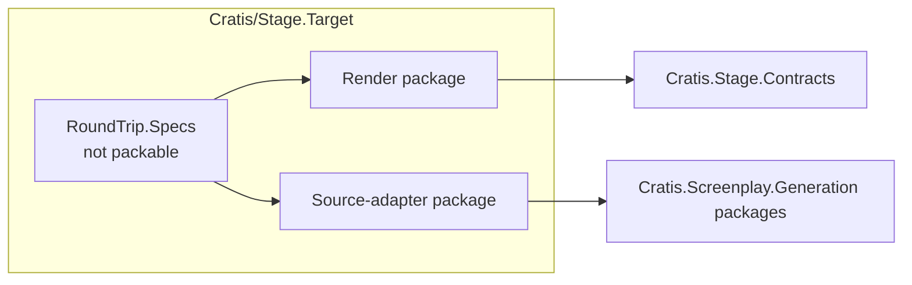

A target can translate in two directions. A **render target** turns a Screenplay model into code for a framework, and a **source adapter** recovers a Screenplay model from code written for that framework. This page explains where Cratis keeps that work for each ecosystem, which packages may depend on which, and how targets are named. To build the pieces themselves, see [Build a renderer target](build-renderer-target.md) and [Build a .NET source adapter](https://github.com/Cratis/Screenplay.Generation/blob/main/Documentation/guides/build-source-adapter.md).

## One repository per third-party ecosystem

Cratis keeps everything it maintains for a third-party ecosystem in one repository named `Cratis/Stage.<Target>`, where `<Target>` is the PascalCase ecosystem name: [Stage.Axon](https://github.com/Cratis/Stage.Axon) for Axon Framework, `Stage.CritterStack` for Marten and Wolverine. The repository is the single place for that ecosystem's issues, documentation, type maps and naming knowledge.

Each direction is optional. A repository can hold a render target, a source adapter, or both:

Frameworks Cratis owns follow a different rule: their translators stay in the framework's own repository. The Arc source adapter, `Cratis.Arc.Screenplay`, lives in [Arc](https://github.com/Cratis/Arc), and the Cratis render target stays in Stage as the reference target. There is no `Stage.Arc` repository.

## Keep the directions one-way

The two directions are separate packages, and their dependencies point one way:

| Project | May depend on | Must never depend on |
| --- | --- | --- |
| Render package | `Cratis.Stage.Contracts` and the target's own framework packages | Any `Cratis.Screenplay.Generation` package |
| Source-adapter package | `Cratis.Screenplay.Generation` packages | `Cratis.Stage.Contracts` |
| `RoundTrip.Specs` (not packable) | Both directions | — |

The rules keep each package's users from paying for the other direction. `Cratis.Stage.Contracts` brings Scene with it, so a source adapter that referenced it would load Scene into every `cratis screenplay generate` run. A render package that referenced Generation would tie every render to the source-adapter SDK and its releases.

`RoundTrip.Specs` is the only project where the directions meet. It renders a model, recovers it with the source adapter, and compares the two, so a regression in either direction fails the same pull request before anything is released.

Stage and Screenplay.Generation never reference a target repository. Hosts such as the [Cratis CLI](https://github.com/Cratis/cli) and Studio bundle the targets they offer.

## Release each direction on its own

The render package and the source adapter may version and release independently, even when they live in the same repository. Before a host bundles a package, validate it against the locked dependency sets of that host, using the published binaries the host restores rather than only the newest common version.

Package ids never change once published. A repository can be renamed, but its packages keep their ids: `Cratis.CritterStack.Screenplay` keeps its id after the repository moves to `Stage.CritterStack`.

## Name packages, ids and diagnostics

| Item | Rule | Example |
| --- | --- | --- |
| Cratis repository | `Cratis/Stage.<Target>`, PascalCase ecosystem name | `Cratis/Stage.Axon` |
| Render package | `Cratis.Stage.Rendering.<Target>` | `Cratis.Stage.Rendering.Axon` |
| Source-adapter package | `Cratis.<Framework>.Screenplay` | `Cratis.CritterStack.Screenplay` |
| Target id | Lowercase, stable forever, because hosts store it with every render | `axon`, `critterstack` |
| Render diagnostic codes | `STAGE-<TARGET>-*` | `STAGE-AXON-*` |

Community targets use their own package prefix, such as `Acme.Stage.Rendering.X` and `Acme.X.Screenplay`, and their own diagnostic prefix. The `Cratis.*` prefix is reserved for packages Cratis maintains.

## Offer only curated targets

Hosts load targets they bundle and have reviewed, and nothing else:

- The CLI and hosted Studio offer curated, bundled targets only. The CLI selects them from a static roster; it does not discover renderer packages in a workspace.
- An untrusted target is refused. The host fails closed and never falls back to another target.
- The same rule applies to source adapters, which run over a user's source code, and to evaluating an untrusted workspace, because MSBuild and Roslyn evaluation runs the workspace's build logic.

Installing your own targets will need an isolated, out-of-process sandbox, which does not exist yet. Until then, a target reaches users by being bundled into a host.

## Check a target repository

- [ ] The repository is named `Cratis/Stage.<Target>`, unless the framework is Cratis-owned.
- [ ] The render package references `Cratis.Stage.Contracts` and no Generation package.
- [ ] The source adapter references Generation packages and not `Cratis.Stage.Contracts`.
- [ ] Only the non-packable `RoundTrip.Specs` project references both directions.
- [ ] Package ids, the target id and diagnostic codes follow the naming rules.
- [ ] The repository documents its supported versions, its known round-trip losses and its limitations.
