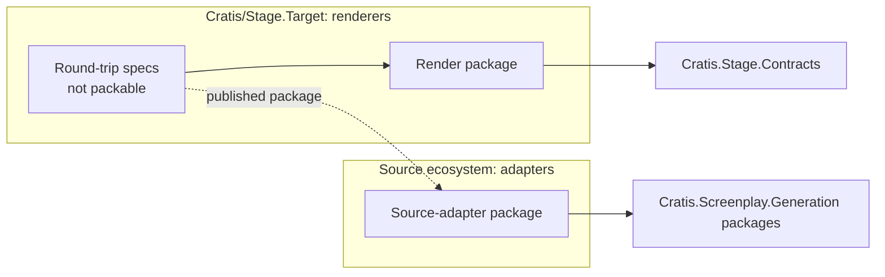

Translation runs in two directions. A **render target** turns a Screenplay model into code for a framework. A **source adapter** recovers a Screenplay model from code written for that framework. Cratis keeps the two directions in separate repository families, each depending only on its own SDK.

This page explains where each direction lives, which packages each may depend on, where round trips run, and how targets are named. To build the pieces themselves, see [Build a renderer target](build-renderer-target.md) and [Build a .NET source adapter](https://github.com/Cratis/Screenplay.Generation/blob/main/Documentation/guides/build-source-adapter.md).

## Two repository families

| Direction | Where it lives | Depends on |
| --- | --- | --- |
| Render (Screenplay → code) | `Cratis/Stage.<Target>` for a third-party ecosystem, such as [Stage.Axon](https://github.com/Cratis/Stage.Axon). The Cratis render target stays in Stage as the reference target. | `Cratis.Stage.Contracts` and the target's own framework packages |
| Source adapter (code → Screenplay) | The source ecosystem's repository. For a Cratis framework that is the framework's own repository: `Cratis.Arc.Screenplay` lives in [Arc](https://github.com/Cratis/Arc). For a third-party ecosystem it is `Cratis/Screenplay.<Ecosystem>`, such as [Screenplay.CritterStack](https://github.com/Cratis/Screenplay.CritterStack). | `Cratis.Screenplay.Generation` packages |

A repository holds one direction. A render package never references a `Cratis.Screenplay.Generation` package, and a source adapter never references `Cratis.Stage.Contracts`.

The split keeps each package's users from paying for the other direction:

- `Cratis.Stage.Contracts` brings Scene with it, so a source adapter that referenced it would load Scene into every `cratis screenplay generate` run.
- The two directions also use different toolchains and trust models. An adapter runs over a user's source code and build logic, while a renderer works from a compiled Screenplay model.

Stage and Screenplay.Generation never reference a target or adapter repository. Hosts such as the [Cratis CLI](https://github.com/Cratis/cli) and Studio bundle the renderers and adapters they offer.

## Run round trips in the renderer repository

A round trip renders a Screenplay model, recovers it with the ecosystem's source adapter, and compares the two models. It lives in the **renderer** repository, in a spec project that is never packed:

- It consumes the source adapter's **published** package, referenced with `PrivateAssets`, so the adapter never becomes a dependency of the render package.
- It renders the pinned `Cratis.Screenplay.CanonicalCorpus` models.
- It runs in CI. A round trip that only compiles locally, or that compares zero models, proves nothing.

When the adapter releases, the renderer repository's package updates bump it and run the round trip again. Stage's own Arc round trip already references the published `Cratis.Arc.Screenplay` this way.

## Release each package on its own

Renderers and adapters release on their own schedules. Before a host bundles a package, validate it against that host's locked dependency set, using the published binaries the host restores rather than only the newest common version.

Package ids never change once published. A repository can be renamed, but its packages keep their ids.

## Name packages, ids and diagnostics

| Item | Rule | Example |
| --- | --- | --- |
| Renderer repository | `Cratis/Stage.<Target>`, PascalCase ecosystem name | `Cratis/Stage.Axon` |
| Source-adapter repository (third-party ecosystem) | `Cratis/Screenplay.<Ecosystem>` | `Cratis/Screenplay.CritterStack` |
| Render package | `Cratis.Stage.Rendering.<Target>` | `Cratis.Stage.Rendering.Axon` |
| Source-adapter package | `Cratis.<Framework>.Screenplay` | `Cratis.CritterStack.Screenplay` |
| Target id | Lowercase, stable forever, because hosts store it with every render | `axon`, `critterstack` |
| Render diagnostic codes | `STAGE-<TARGET>-*` | `STAGE-AXON-*` |

Community renderers and adapters use their own package prefix, such as `Acme.Stage.Rendering.X` and `Acme.X.Screenplay`, and their own diagnostic prefix. The `Cratis.*` prefix is reserved for packages Cratis maintains.

## Offer only curated targets

Hosts load renderers and adapters they bundle and have reviewed, and nothing else:

- The CLI and hosted Studio offer curated, bundled targets only. The CLI selects them from a static roster; it does not discover renderer packages in a workspace.
- An untrusted target is refused. The host fails closed and never falls back to another target.
- The same rule applies to source adapters, which run over a user's source code, and to evaluating an untrusted workspace, because MSBuild and Roslyn evaluation runs the workspace's build logic.

Installing your own targets will need an isolated, out-of-process sandbox, which does not exist yet. Until then, a target reaches users by being bundled into a host.

## Check a renderer repository

- [ ] The repository is named `Cratis/Stage.<Target>` and holds renderers only.
- [ ] No packable project references a `Cratis.Screenplay.Generation` package.
- [ ] The round-trip spec project is not packable, references the source adapter's published package with `PrivateAssets`, and runs in CI.
- [ ] Package ids, the target id and diagnostic codes follow the naming rules.
- [ ] The repository documents its supported versions, its known round-trip losses and its limitations.
