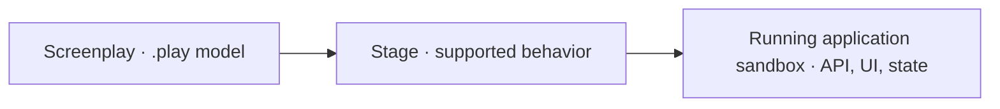

import { Aside, Card, CardGrid, Steps } from '@astrojs/starlight/components';

Cratis Stage performs a Cratis Screenplay `.play` model as an application sandbox, so you can try its commands
and queries before implementing the application. Start a session, submit a command, and inspect the resulting
state and recorded events in Cratis Chronicle. Stage executes a supported subset of Screenplay; it is not a
production host. Rendering application source and running modeled specifications are separate paths.



Stage executes the admitted model directly; you do not need to generate and build an application first.

Screenplay's model is language-neutral. Rendering is a separate, target-specific
choice: the Cratis renderer produces C#/Arc/Chronicle and React artifacts, while
other targets, such as [Stage.Axon](https://github.com/Cratis/Stage.Axon), own their
output and capability limits. A supported sandbox session does not establish
support in another renderer. See the [target repository model](guides/target-repository-model.md)
for target boundaries and host admission rules.

<Aside type="caution" title="A sandbox, not a production runtime">

Use Stage for temporary model exploration. Its bundled Chronicle kernel uses in-memory storage with authentication
disabled; replacing the container loses session state. Compilation does not mean every construct can execute.
Check admission and keep the session private on loopback. A sandbox session or model check does not establish
that a rendered application works.

</Aside>

## Start here

Have the [Cratis CLI installed](/cli/getting-started/), Docker running, and a complete Screenplay model in
`./screenplays`. The CLI selects its compatible Stage image; first use may need to pull it. This short path is
for a model without declared authentication; see the [CLI run reference](/cli/reference/run/) for authenticated models.

<Steps>

1. [Author a Screenplay model](/screenplay/getting-started/) with commands, event productions, read models,
   projections, and queries. A read model is a view built from events; its projection describes how those events
   update the view. Include the concepts and policies the model references, since introductory excerpts alone
   are not a complete application. Screens are optional: Stage can compose a default UI.
2. Run the model folder:

   ```bash
   cratis run ./screenplays
   ```

   Stage compiles the source and reports readiness or refusals. The CLI mounts the model read-only and binds
   the standalone API and Workbench to loopback by default; do not add `--allow-remote`.
3. Open the [application](http://localhost:9090/) and the interactive API reference,
   [Scalar](http://localhost:9090/scalar/v1). Check [status](http://localhost:9090/stage/status) and
   [admission](http://localhost:9090/stage/semantic/admission) for behavior Stage cannot execute. Then submit a
   supported command using its model-specific schema. Query the corresponding read model or view its screen
   to see the resulting state.

</Steps>

Continue with [Start a disposable session](docker/index.md#start-a-disposable-session) for the Docker alternative,
command-to-state checks, and event inspection.

## What you get

The session exposes mapped commands, queries, and validation endpoints through HTTP, with OpenAPI and Scalar
for discovering their schemas. Unsupported behavior can return a refusal or HTTP 501, so a responding host alone
is not proof that an operation works.

For the UI, Stage uses authored Scene screens or composes default per-slice screens from admitted commands and
read models. These let you try the model; they are not a finished custom product interface. Accepted commands
produce facts in the bundled Chronicle event log. Projections and queries expose the sandbox's in-process read
state, while Workbench lets you inspect events, not semantic projection views.

To check authored expectations, request a separate specification run and inspect each outcome. Startup does not
run a passing suite, and unsupported specifications are not passes.

## Choose your next step

[Run and inspect the model](docker/index.md), [check specifications](docker/spec-runner.md), or
[plan reviewable application source](reference/plan-from-sources.md). Each path admits its own supported constructs.

<CardGrid>
  <Card title="Run your Screenplay">
    [Start a private session](docker/index.md), use the application, and inspect state and events.
  </Card>
  <Card title="Check model behavior">
    [Run specifications separately](docker/spec-runner.md) and read their outcomes.
  </Card>
  <Card title="Plan application source">
    [Inspect a render plan](reference/plan-from-sources.md) before publishing files.
  </Card>
  <Card title="Author the model">
    [Describe commands, facts, views, and queries in Screenplay](/screenplay/getting-started/).
  </Card>
</CardGrid>

## Why use Stage

Use a sandbox session to check how a modeled command changes the state a query returns. When you want to
implement the application, Stage's renderer turns supported declarations into concrete commands, event mappings,
queries, and project files for a specific Cratis target.

You can review the output before writing it. Semantic planning returns normalized paths, exact bytes, SHA-256
hashes, and typed diagnostics in memory; publishing is a separate operation. The `Cratis.Stage.Rendering.Cratis`
package owns dependency pins, scaffold inputs, and renderer identity, so callers choose project and namespace
names without reconstructing a profile.

Choose application, module, feature, or slice scope for the work at hand. Common artifacts have the same bytes
when their inputs match across scopes. Unsupported reachable semantics block publication by default; explicit
[refusal modes](reference/stage-rendering.md#render-around-refused-specifications) have narrower guarantees.

Stage does not require Studio: `.play` files are its input. Cratis Studio is an optional paid collaborative design
workspace built on Chronicle, open for sign-up with a 14-day free trial and per-seat pricing. Studio's Play uses
Stage. Arc and Chronicle can also be used without the model-first layer.

## What works today

### Renderer

Rendering produces source you own, rather than starting the sandbox. Use `CratisRendering.Plan` when your caller already has an executable
semantic model and an admitted execution plan. This C# excerpt assumes those existing `semanticModel` and
`executionPlan` values; it is not a standalone program:

```csharp title="Plan artifacts from an admitted model"
using Cratis.Stage.Contracts.Rendering;
using Cratis.Stage.Rendering.Cratis;

var options = new CratisRenderingOptions("Projects", "Projects");
var scope = new ArtifactRenderScope(
    ArtifactRenderScopeKind.Application, semanticModel.Application.Id);
var plan = CratisRendering.Plan(semanticModel, executionPlan, scope, options);

if (!plan.Success)
{
    foreach (var diagnostic in plan.Diagnostics)
    {
        Console.Error.WriteLine($"{diagnostic.Code}: {diagnostic.Message}");
    }
}
```

`Plan` creates the package-owned profile; no target version or template bytes need to be invented by the caller.
Inspect diagnostics and require `plan.Success` before considering publication. The plan does not write your
files. For loading `.play` source and checking a destination before writing, continue with
[Plan artifacts from Screenplay sources](reference/plan-from-sources.md).

Lower-level callers can use `CratisRendering.CreateProfile(...)` with `ArtifactRenderRequest`; a reconstructed or
modified profile is not interchangeable. See [renderer compatibility](reference/renderer-compatibility.md) for
profile admission and legacy syntax-renderer contracts, and [rendering reference](reference/stage-rendering.md)
for current semantic capabilities.

### Runtime host

The `cratis/stage` container starts Arc, an in-memory Chronicle kernel, OpenAPI/Scalar, and the admitted model API.
The semantic engine is the default. It evaluates supported behavior and refuses unsupported constructs rather
than silently dropping them. See [semantic execution](docker/index.md#opt-in-to-semantic-execution) for admission
and operational limits. The legacy `eventmodel` engine is deprecated and scheduled for removal in Stage v6.

### Specification runner

`cratis/stage-specrunner` compiles the model, checks its declared specifications, writes `results.json`, and exits.
Choose `--engine semantic` for behavioral model checks; the deprecated default `structural` engine checks model
consistency. Semantic reports use `stage-spec-run/1`, not the legacy structural schema. Read each reported outcome:
a completed run can exit `0` even when specifications fail or are unsupported.

## Curtain up

For the full model-to-application flow, follow [Start a disposable session](docker/index.md#start-a-disposable-session).
You need an existing Screenplay model before starting the container; an empty mounted folder exits before startup.
The [Cratis CLI](/cli/reference/run) also wraps the container in `cratis run`.

## Packages and containers

| What | Image / package | Purpose |
| --- | --- | --- |
| The Stage host | `cratis/stage` | Disposable semantic runtime with Arc, Chronicle, and the admitted model API. |
| The specification runner | `cratis/stage-specrunner` | Run-to-completion model-level specification verification. |
| The renderer | `Cratis.Stage.Rendering.Cratis` | Semantic artifact planning plus the syntax-based compatibility renderer. |
| The contracts | `Cratis.Stage.Contracts` | Internal/tooling seams and specification results. |

## Where to go next

- [Customize a rendered application](guides/customize-rendered-application.md) — add services, dependencies, and frontend styling from unmanaged files.
- [Build a renderer target](guides/build-renderer-target.md) — implement a deterministic Screenplay-to-code target with Stage's planning contracts.
- [URLs of a running Stage](reference/urls.md) — look up runtime endpoints and their current behavior.
- [Scene UI render plans](reference/render-plans.md) — inspect resolution for each `ui profile` and its diagnostics.
